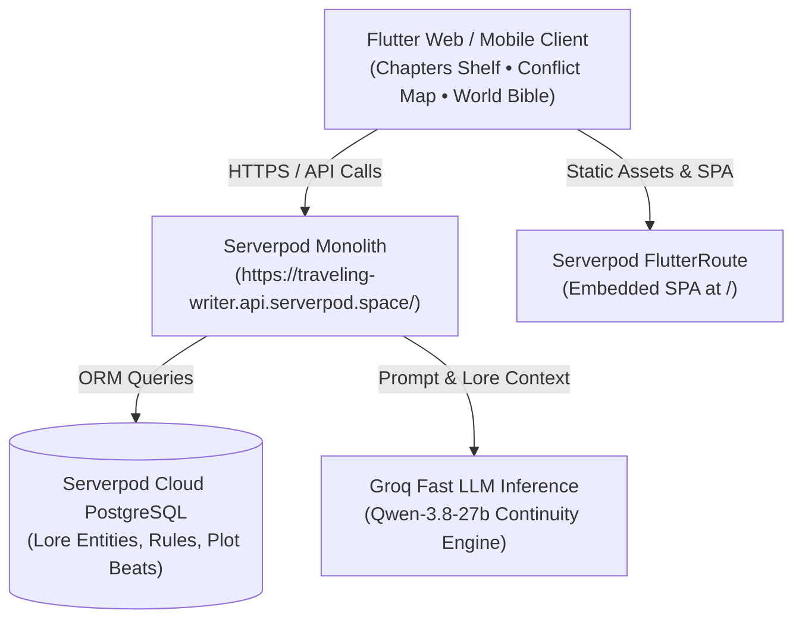

# Traveling Writer 🖋️🌌
**AI-Powered Fiction Writing & Continuity Guardian**  
*Built for the FlutterBytes × Serverpod Hackathon 2026*

---

## 🚀 Live Serverpod Cloud Deployment

| Service | Live URL |
| :--- | :--- |
| **Interactive Web App** | [https://traveling-writer.serverpod.space/](https://traveling-writer.serverpod.space/) |
| **Serverpod Cloud API** | [https://traveling-writer.api.serverpod.space/](https://traveling-writer.api.serverpod.space/) |
| **Serverpod Insights** | [https://traveling-writer.insights.serverpod.space/](https://traveling-writer.insights.serverpod.space/) |
| **Project ID** | `traveling-writer` |

---

## 📖 What is Traveling Writer?

Writers often struggle with narrative continuity across complex fantasy and sci-fi sagas. When a story stretches across tens of thousands of words, keeping track of character traits, magic systems, physical laws, and timelines is nearly impossible without costly continuity editors.

**Traveling Writer** solves this with a real-time fiction writing studio backed by an automated continuity guardian:
1. **Chapter Manuscript Shelf & Editor**:
   - Land directly on a visual shelf of chapter preview cards (word counts, excerpt snippets, and lore conflict status).
   - Tap any chapter preview to open the full Drafting Canvas and paragraph-by-paragraph Continuity Inspector.
   - Start a new chapter anytime using the floating **`+`** button in the lower-right corner.
   - All chapters share the parent World Bible canon, rules, and AI continuity engine.
2. **Plot & Chapter Conflict Canvas**:
   - Sequential story arc timeline that visualizes the health of your manuscript.
   - Chapters with lore contradictions or plot holes are highlighted with **bold RED borders and alert badges**, showing the exact broken rules and offending quotes.
   - 1-click **`[Fix Conflict in Story Studio →]`** jump directly opens the offending chapter in the editor.
3. **Automated World Bible Rule Discovery**:
   - While authors write prose, the engine checks for newly asserted constraints, physical laws, and vows (e.g., *"Lord Morvath cannot touch silver"* or *"Elena requires silver arrows"*).
   - In-editor subtle banner: *"✨ X potential new lore rules detected in this draft. `[Review in World Bible →]`"*.
   - Unintrusive notification badge on the **World Bible** navigation tab displaying pending rules count.
   - Authors can review candidate rules and click **`✓ Accept & Add to Canon`** (committing directly to the Serverpod Cloud database) or **`✕ Discard / Ignore`**.
4. **World Bible (Canon)**:
   - Define characters, artifacts, factions, and strict lore constraints with severity levels.
5. **Mobile & Desktop Responsive**:
   - Seamlessly adapts with touch-friendly bottom navigation, compact action bars, and responsive card layouts.

---

## 🛠️ Architecture & Tech Stack



- **Backend**: [Serverpod 2.4.0](https://serverpod.dev/) deployed on **Serverpod Cloud**.
- **Frontend**: Flutter Web (CanvasKit / HTML5) with full mobile breakpoints (`isMobile = width < 640`).
- **Database**: Serverpod Cloud Managed PostgreSQL.
- **AI Inference**: Groq high-speed LLM engine integrated securely via Serverpod Cloud Secrets (`GROQ_API_KEY`).
- **Zero-CORS Web Hosting**: Served directly from Serverpod's built-in `FlutterRoute(Directory('web/app'))` with SPA fallback.

---

## 💻 Running Locally

### Prerequisites
- Dart SDK 3.8+ & Flutter 3.29+
- Docker & Docker Compose (for local PostgreSQL)

### 1. Start Serverpod Backend
```bash
cd traveling_writer/traveling_writer_server
dart run bin/main.dart
```

### 2. Run Flutter App
```bash
cd traveling_writer/traveling_writer_flutter
flutter run -d chrome
```

---

## 🏆 Hackathon Submission Checklist

- [x] Project deployed live on Serverpod Cloud.
- [x] Serverpod Cloud Project ID: `traveling-writer`.
- [x] Chapter Manuscript Shelf with preview cards and floating `+` button.
- [x] Plot & Chapter Conflict Canvas highlighting conflicting chapters in bold RED.
- [x] Automated World Bible Rule Discovery from chapter drafts with badge notification flow.
- [x] Functional Story Studio with AI Continuity Auditing.
- [x] World Bible with customizable entities and rule constraints.
- [x] Mobile-responsive layout for phone browsers.
- [x] Live API verification script (`traveling_writer_client/bin/test_live.dart`).
